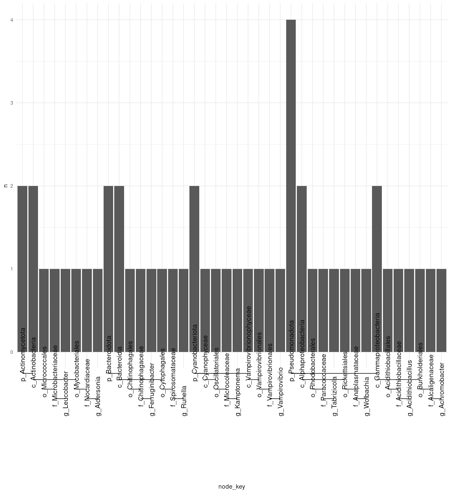
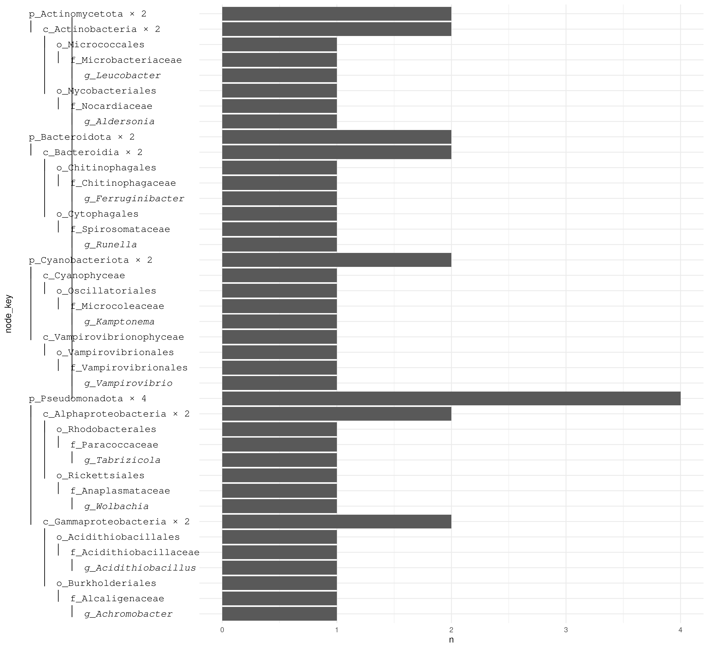

# dirtree

Directory-style taxonomy trees as **ggplot2 axis labels**.

`dirtree` replaces the flat text labels of a discrete position axis with a
tree that reads the way a file listing does: every axis break becomes a node,
indented one rank per level and joined to its parent's trunk by an elbow
connector, the way the LaTeX [dirtree package](https://ctan.org/pkg/dirtree)
draws ranked hierarchies. Long taxonomies — e.g. amplicon lineages from
phylum to genus — stay navigable on the axis instead of collapsing into
repeating prefixes.





## Features

- **`guide_dirtree()`** — a ggplot2 axis guide (x or y, bottom or left).
  Builds the tree from a node table; you plot on its `node_key` column as
  usual.
- **`dirtree_data()`** — collapses a lineage table (one row per leaf, one
  column per rank) into the depth-first node table the guide consumes.
- **Gold-pixel geometry** — rank pitch 1.4 em, corner columns and elbow
  connectors transcribed from the LaTeX `dirtree` package's `\DTsetlength`
  values, reproduced from its reference render rather than invented.
- **Both orientations** — a bottom axis whose tree hangs from the plot axis
  with the leaves dangling away, and a left axis with the classic outermost
  trunk (verified pixel-identical across sessions).
- Monospace labels with italic species/genus names, matched to the reference
  generator's typography.

## Installation

```r
# install.packages("devtools")
devtools::install_github("zjardyn/dirtree")
```

## Usage

```r
library(dirtree)
library(ggplot2)

d <- dirtree_data(subset(tax_lineages, marker == "16S"))

ggplot(d, aes(x = node_key, y = n)) +
  geom_col() +
  scale_x_discrete(limits = d$node_key, breaks = d$node_key) +
  guides(x = guide_dirtree(nodes = d)) +
  theme_minimal() +
  theme(axis.text.x = element_blank())
```

Swap `aes(x = ...)` for `aes(y = ...)` (with the matching discrete scale and
`guides(y = ...)`) for the left-axis orientation. `?guide_dirtree` documents
the full interface; `tax_lineages` ships as example data.

## Status

Pre-release (`0.0.0.9000`): the API may still move. Top/right positions are
not supported yet.

## License

MIT © 2026 dirtree authors
